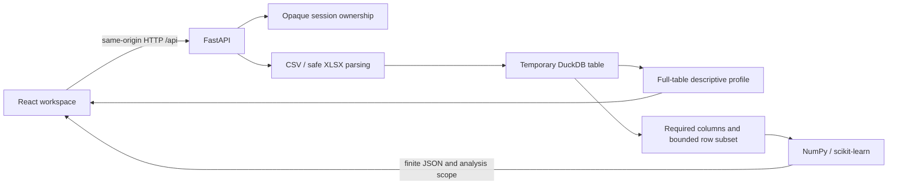

# How the project works

This guide follows the implementation from a browser action to a result. See [analysis methods](analysis-methods.md) for the mathematics and [security](security.md) for the trust boundaries.

## The system in one diagram

There is one Python service. In production it also serves `frontend/dist`. In development Vite serves React and proxies `/api` to Python. No uploaded value goes to an external AI API.

## 1. Opening the app

`App.jsx` calls `GET /api/session`. The server reads an HTTP-only cookie, validates its opaque-token format, hashes it for the registry key and looks up the browser's dataset. If no usable cookie exists, it creates a cryptographically random token. A valid-looking guessed token does not grant access to another owner's table.

The response contains the current dataset profile or `null`. The frontend starts on Data Source or restores the loaded dataset. Hash navigation (`#overview`, `#forecast`, etc.) supports browser Back and reload without requiring separate server-rendered pages.

The cookie identifies an anonymous browser session, not an account. Tabs in the same browser profile share it. A different browser/incognito context gets its own ownership token. There is no owner password or admin panel in this project.

## 2. Receiving a table

The browser sends a `FormData` file and `X-Requested-With: AI-Data-Analyzer`. XMLHttpRequest exposes real upload progress. Once upload reaches 100%, the UI changes to profiling; it does not invent a percentage for parsing or model computation.

Before expensive handling, middleware checks same-origin mutation requirements and a two-job concurrency budget. Multipart file content is spooled by the framework rather than collected into one unbounded Python byte string. The application then copies it in 1 MiB chunks to a generated temporary path, checking free storage and CSV encoding/control characters along the way. Client filenames are labels only; they are never used as filesystem paths.

CSV headers must be unique, non-empty and bounded in width/name length. The CSV reader is strict; unsupported binary/control characters and invalid UTF-8 are rejected. No value is evaluated as Python, JavaScript, SQL or a spreadsheet formula.

For `.xlsx`, the archive is inspected before workbook reading: entry count, expanded content, paths, encryption, macros, formulas, embedded objects and external relationships. XML is inspected with `defusedxml`; worksheet values are streamed to an intermediate CSV. Only the first worksheet is imported. Large workbooks should be exported as CSV.

DuckDB creates a disk-backed table from the validated CSV using a bounded-memory, single-thread connection. The reader infers types from the file; inconsistent numeric/text columns may become text rather than being silently coerced into misleading numbers. Nonfinite numeric values are stored as missing. Extreme magnitudes that exceed the stable model range are rejected with guidance to rescale.

## 3. Profiling without loading the whole table into pandas

`build_profile()` queries the stored table for row counts, column types, completeness, ranges, means, standard deviations and histogram bins. Medians and high-cardinality distinct counts become approximate on large tables. Low-cardinality distinct counts are refined exactly so a classification target is not hidden by an approximate count near 20 classes.

The preview contains at most 50 rows, and text preview values are limited to 256 characters. Full stored values remain in the temporary table. These limits protect the browser response rather than limiting ingestion.

CSV missing-value markers are empty cells, `NA`, `NaN`, `nan` and `NULL`. Clean or encode those strings first if they are intended as literal category labels.

An internal record-position column has a collision-free name and is excluded from public schema/profile fields. Source columns named `rowid`, `__row` or `__displayRow` therefore remain ordinary user data.

Only after parsing and profiling succeed does `DatasetStore.put()` replace the previous dataset. If the upload fails, the prior session table remains available. There is one active table per session.

The request obtains a pending-write lease before multipart parsing. Clear data or a newer upload invalidates that lease; an older parse cannot subsequently restore or replace data. Multipart handling explicitly limits file/field counts and metadata memory rather than using permissive framework defaults.

## 4. Running an analysis

The frontend posts a typed request containing the current `datasetId` and selected parameters. The route verifies ownership before opening the table. The dataset ID is random but is not a substitute for ownership validation.

`TableData.model_frame()` selects only the necessary columns. Numeric models never materialize unrelated large text columns. It loads all rows up to 25,000. For larger datasets:

- Clustering, classification and insights use a deterministic reservoir sample.
- Forecasting selects the latest 25,000 rows by the requested date, or the last 25,000 rows in file order.

Only this bounded projection becomes a pandas DataFrame. The actual dataset stays on disk. The route attaches `analysisScope` to every successful model response; the UI displays it beside the result.

`analysis.py` handles mathematical validation: finite complete rows, meaningful feature lists, class counts, train/test feasibility, date cadence and model-specific constraints. Request-shape bounds live in `schemas.py`. JSON-safe conversion handles NumPy scalars, missing values, dates and infinities.

The two-job budget includes parsing and analysis. Model code limits numerical-library threads to avoid exhausting CPU cores. This is a bounded interactive service, not an unbounded background-worker queue.

## 5. Rendering and preserving useful state

The app shell owns the loaded profile and a per-workflow cache. Each analysis view uses `useAnalysis()` for settings, completed results, errors and cancellation. A changed parameter marks existing results stale; the user can still inspect them while requesting a new calculation.

Leaving a view cancels its browser request and prevents a late response from changing the unmounted screen. Changing or clearing the dataset resets all view caches. Cancellation does not forcibly interrupt a Python calculation that already started; the UI says so.

Completed model results survive section navigation but not a full browser reload. Reload restores only the current server dataset/profile. This distinction avoids implying durable saved analysis projects.

Heavy chart views are lazy-loaded. Overview's histogram is a small code-native component, so loading the initial dataset screen does not require the full charting library. Fonts are hosted with the app, not requested from Google Fonts.

## 6. Responsive behavior and motion

Desktop uses a fixed navigation rail and an open workspace. Below 900px, navigation becomes a native modal dialog with focus containment, Escape/backdrop close and focus restoration. The data inspector stacks below the table on narrow screens. Tables scroll inside their own regions and paginate to five rows on phones, ten otherwise.

Series use a consistent multicolor palette, text legends and line styles. A forecast is dashed; a cluster has a number and count. Information is not conveyed by color alone.

Short CSS transitions and new-result chart reveals clarify changes. Cached results do not replay their entrance on every section return. `prefers-reduced-motion` disables nonessential motion in both CSS and chart props.

## 7. Expiry, deletion and process lifetime

The registry stores table handles, profiles, IDs and idle timestamps in process memory. Table contents live in generated temporary directories. API accesses renew the idle timestamp. Lazy cleanup and a once-per-minute task remove expired tables. Clear data removes the active table; a normal shutdown closes all table handles and cleans their directories.

Keep one Uvicorn worker and one service instance. A second process would have a different registry and could not reliably find the first process's datasets. For horizontal scaling, move ownership and job state into shared storage rather than increasing the worker count.

A crash or forced termination can bypass normal cleanup. Temporary files are not a durable user feature and are not claimed to be securely erased. Sensitive production data needs a different storage/security design.

## Main engineering decisions

| Decision                | Reason                                                                               | Cost / limitation                                                    |
| ----------------------- | ------------------------------------------------------------------------------------ | -------------------------------------------------------------------- |
| React + Vite retained   | Component UI and fast development; avoids a gratuitous framework migration           | Requires a build step                                                |
| FastAPI retained        | Python data/ML ecosystem and typed request validation                                | Needs a Python host                                                  |
| DuckDB temporary tables | Full-table profiling and million-row CSV ingestion without whole-file pandas loading | Temporary disk and query resources are finite                        |
| Bounded model subsets   | Predictable interactive memory/latency                                               | Results on large data describe the subset, not every stored row      |
| Anonymous owner cookie  | Prevents cross-visitor access without an account platform                            | Shared browser tabs share ownership; no saved account workspaces     |
| No external LLM         | Existing algorithms do not require one; avoids data transfer, secrets and cost       | Explanations are authored model notes, not generated interpretations |
| Native controls/dialogs | Keyboard and touch behavior with little dependency overhead                          | Still needs real browser/accessibility testing                       |
